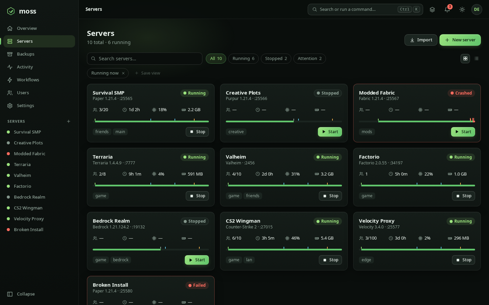
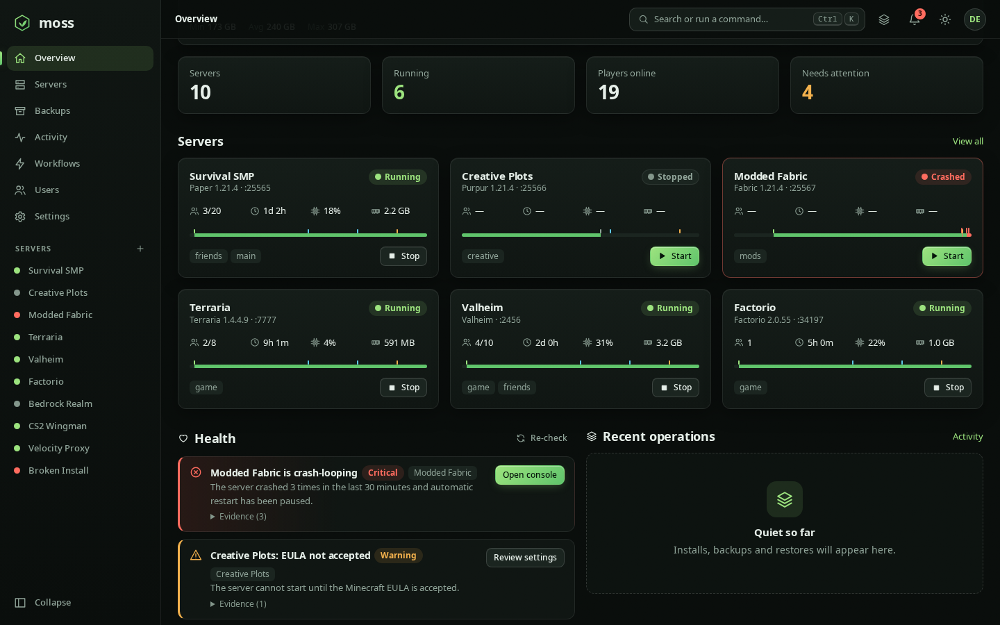
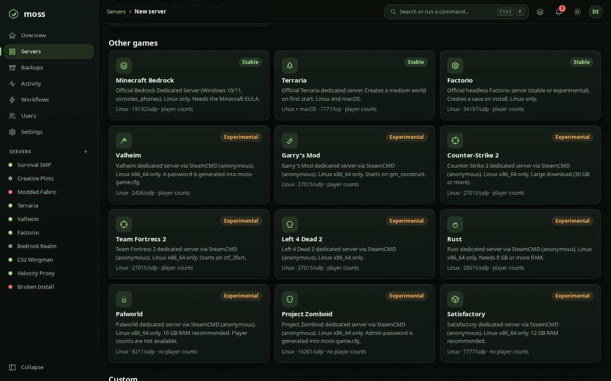
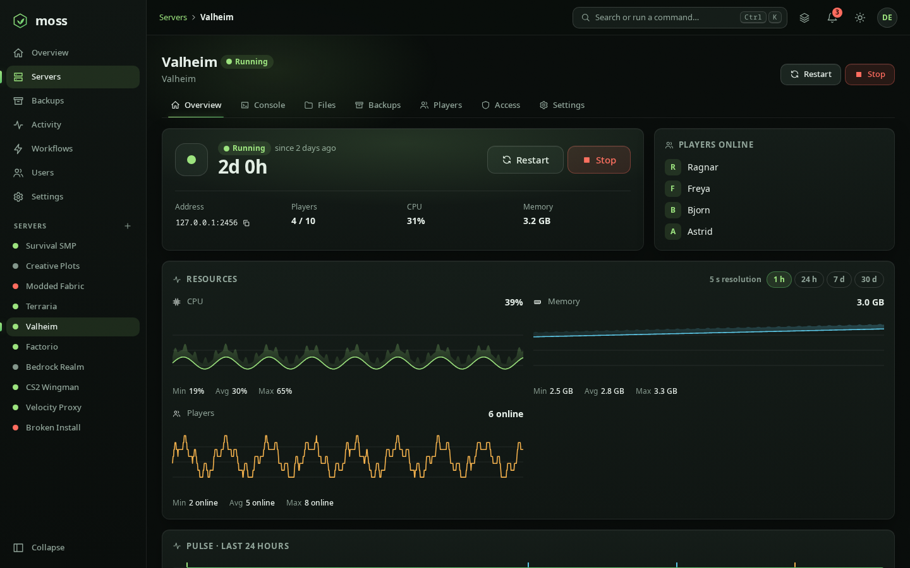
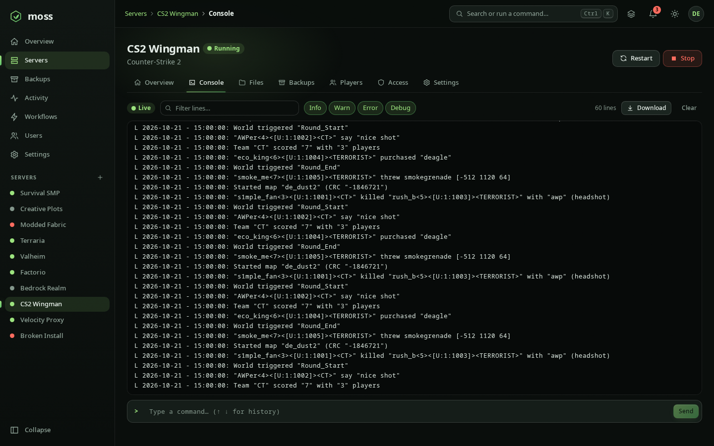
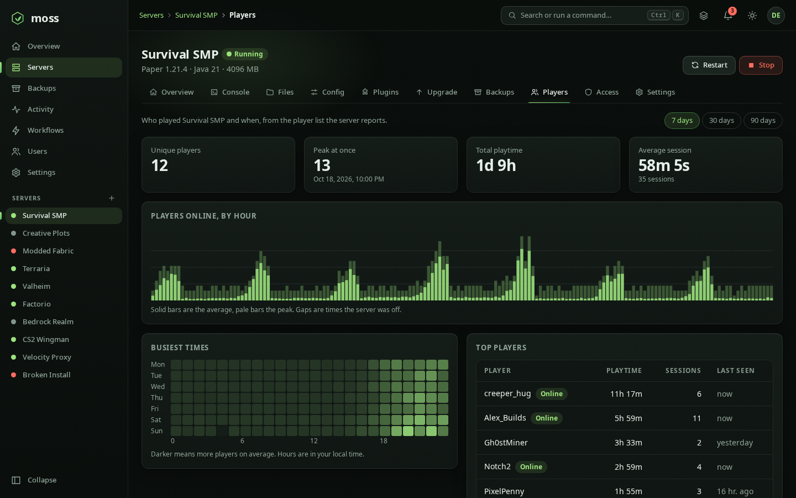
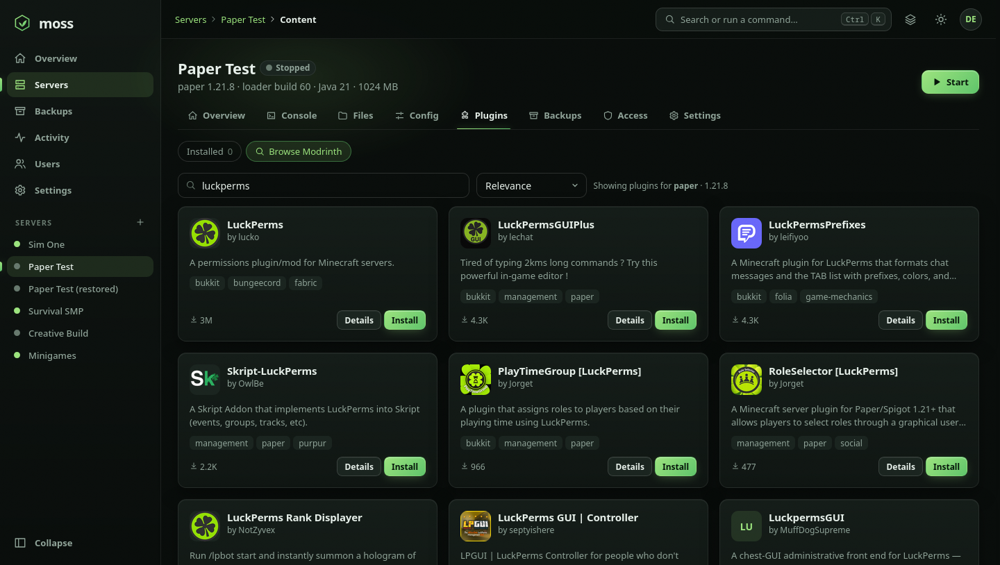
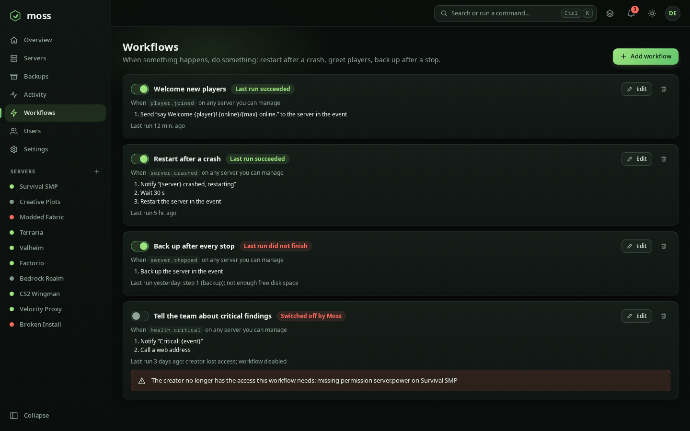
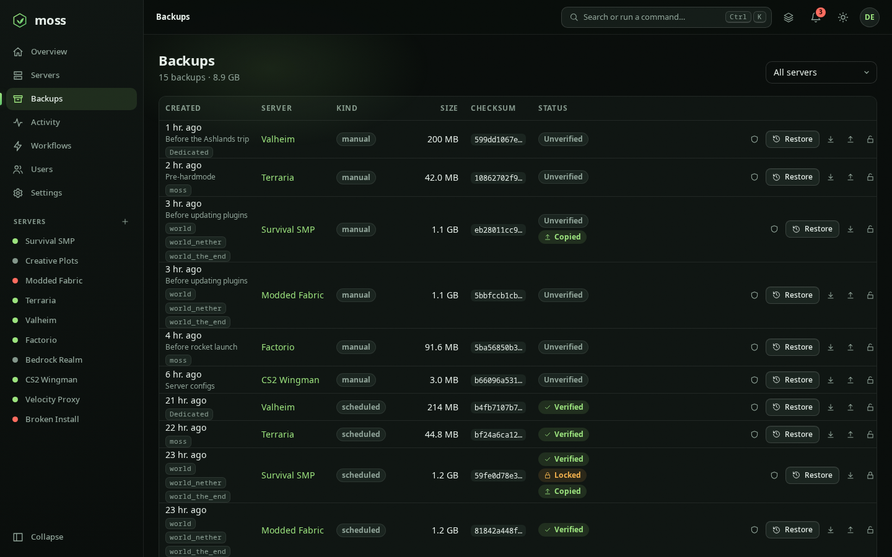

<p align="center">
  
</p>

<h1 align="center">Moss</h1>

<p align="center">
  <strong>Game servers that keep growing, quietly.</strong><br>
  A fast, local-first controller for Minecraft and nineteen other game servers on Linux and macOS: one small binary, a polished web panel, full mod and plugin support with compatibility checks, and servers that survive everything except you pulling the plug.
</p>

<p align="center">
  
  
  
  
  
</p>

<p align="center">
  
</p>

> [!WARNING]
> **Early development.** Moss runs real servers today, but storage formats and APIs may change between versions, and servers run as the same OS user as Moss unless you switch a server to **container isolation** (Docker or Podman). Container mode was verified in tests against a stand-in for the engine, so treat it as new. Keep backups of anything you care about, and do not expose Moss to the internet without a TLS reverse proxy.

## Table of contents

- [Overview](#overview) · [Features](#features) · [Quick start](#quick-start) · [Sign-in](#sign-in) · [Configuration](#configuration)
- [Runtimes](#runtimes) · [Mods and compatibility](#mods-and-compatibility) · [Security model](#security-model) · [Platform support](#platform-support)
- [Current limitations](#current-limitations) · [Roadmap](#roadmap) · [Documentation](#documentation)

## Overview

Moss installs, runs, watches, updates and backs up game servers on a machine you own. It is a single Rust binary that embeds its web UI, keeps state in SQLite, needs no Docker (container isolation is optional) and no hosted backend, and uses Supabase **only** to sign people in.

- **Fast and small.** One binary, a Svelte UI with no UI framework (about 34 KB of JavaScript on first load, gzipped), live state over Server-Sent Events and WebSockets, no polling storms. Idle cost is a few tens of MB.
- **Local first.** Server files, worlds, console logs and backups never leave your machine. The controller works offline except for downloads and the content catalogues.
- **More than Minecraft.** Bedrock, Terraria, Factorio, Valheim, Counter-Strike 2, Counter-Strike: Source, Garry's Mod, Team Fortress 2, Left 4 Dead and Left 4 Dead 2, Day of Defeat: Source, Half-Life 2: Deathmatch, No More Room in Hell, Rust, ARK: Survival Evolved, 7 Days to Die, Palworld, Project Zomboid and Satisfactory install from their official sources (SteamCMD for Steam games), with player counts, console, backups and schedules.
- **Honest about compatibility.** Plugins for Paper-family servers from Modrinth, CurseForge or Hangar, mods for Fabric, Quilt, Forge and NeoForge, proxy plugins for Velocity, datapacks for Vanilla. Moss reads every jar, checks dependencies, versions and loaders, and tells you what is wrong before the server does.
- **Recoverable.** Every change Moss makes can be undone, risky changes take a safety backup first, backups are checksummed and verifiable, and restores never delete what they replace.

## What makes Moss different

| | |
|---|---|
| **Servers outlive the controller** | Games are launched detached and re-attached by PID + start time. Kill or upgrade Moss mid-game and the server, its console and its players are untouched. An end-to-end test `SIGKILL`s the controller on every CI run. |
| **Compatibility checks on real jars** | Moss reads `fabric.mod.json`, `mods.toml`, `plugin.yml` and friends: missing dependencies, version ranges, duplicates, declared incompatibilities, wrong loader, wrong game version, client-only mods, corrupt files. |
| **Version upgrade assistant** | Pick a target Minecraft version and see, per mod, whether a compatible build exists, before anything changes. Then upgrade with a backup, rollback on failure and one operation log. |
| **Undo and safety backups** | Editor saves, `server.properties` and content changes snapshot the previous files; installs, updates, upgrades, modpack imports and restores take a pre-change backup first (the *Back up before risky changes* setting). |
| **Change plans** | Installing or updating shows exactly which files will be added, replaced or broken, dependencies included, before anything is downloaded. |
| **Backups you can trust** | Flushed (`save-off`, `save-all flush`), checksummed `tar.zst`, verified on demand, locked against pruning, previewed before restore (added, removed, changed), restorable as a new server, in place, or per world. |
| **Pulse timeline and health** | A 24-hour strip of starts, crashes, restarts, backups and upgrades, and evidence-backed findings (Java missing, crash loop, no backup, disk full, content problems), each with a one-click fix. |
| **Zero-setup Java** | A checksum-verified Temurin runtime for the Java version each Minecraft release needs, for Linux and macOS. |
| **Event workflows** | *When this happens, do that*: restart after a crash, greet players, back up after every stop. Any webhook event can trigger start, stop, restart, console commands, backups, waits, notifications or a web call, with a dry run, loop protection and the creator's permissions re-checked on every run. |
| **Player analytics** | Who played, when and for how long: unique players, peak, playtime, an hourly chart, a weekday-by-hour heatmap and top players, kept 90 days. |
| **Public status pages** | Opt-in pages anyone can open without signing in: chosen servers, online state, players and uptime, server-rendered with a strict CSP and nothing private in them. |
| **Remote admin for games** | Moss sets up RCON for Source games, Rust, Factorio, Palworld and Project Zomboid with a generated password, shows who is online and can kick or ban them from the Players tab. |
| **Game mods** | Thunderstore mods with BepInEx for Valheim, the Factorio mod portal, and Steam Workshop collections and maps for Garry's Mod and CS2, see [docs/game-mods.md](docs/game-mods.md). |
| **Game updates** | Checks Steam build ids, Factorio, Terraria and Bedrock releases; one click (or a `game_update` schedule) updates with a backup first and keeps your configs and worlds. |
| **Game config editors** | Form editors for `server.cfg`, `serverconfig.txt`, `server-settings.json`, `PalWorldSettings.ini`, Zomboid's server ini and `moss-game.cfg`, with a raw view. |
| **Shared player lists** | Allow and ban lists defined once and applied to every subscribed Minecraft Java and Bedrock server; ban lists also reach games with an admin channel while they run, see [docs/player-lists.md](docs/player-lists.md). |
| **Live maps** | A web map plugin (BlueMap, Dynmap, squaremap, Pl3xMap) shown in a Map tab and, if you choose, on the public status page, through a sandboxed proxy; a map link stops working as soon as its holder loses access, see [docs/maps.md](docs/maps.md). |
| **Installable app and push** | The panel installs as an app and sends Web Push notifications (crashes, backups, players joining) to phones and desktops, see [docs/push.md](docs/push.md). |
| **Command palette** | <kbd>Ctrl</kbd>/<kbd>⌘</kbd>+<kbd>K</kbd> reaches every page, server and action. |

## Features

**Servers** · Vanilla, Paper, Purpur, Folia, Fabric, Quilt, Forge, NeoForge and Velocity from official metadata, plus [other games](#other-games), checksum-verified where upstream publishes one · start, graceful stop, restart, force stop with escalation · crash detection with backoff and a crash-loop breaker · autostart · per-server memory (capped at this machine's RAM), flags profile and port · **import an existing server** from a folder, zip or tar.zst (drag and drop; its plugins and mods are identified right away) · **blueprints** to create new servers from a saved recipe, shareable as a copy-and-paste code · EULA acceptance is an explicit, audited step: accept when creating or importing, or *skip for now* and accept later from the server page (the server will not start until you do) · install and import logs stay on the server's **Setup** tab.

**Isolation and limits** · optional **container mode** (Docker or Podman): one mounted folder, no capabilities, read-only root, memory/CPU/process limits, Java provided by the image · on Linux, cgroup limits without containers · servers survive controller restarts in both modes.

**Console** · live WebSocket console shared by any number of viewers, command history, bounded buffers, survives controller restarts · sensitive commands are redacted in the activity log.

**Files and config** · browse, upload, download, edit, rename, delete, confined to the server folder · form-based `server.properties` · **structured editors with history and diffs for Paper, Spigot, Bukkit, Purpur and Velocity config files** (comments kept, raw editor always available) · undo for every save.

**Content (Modrinth, CurseForge and Hangar)** · search filtered by runtime, loader and game version · dependency resolution · inventory read from the jars · enable/disable · identify unknown files by hash · compatibility panel · update-all with a reviewed plan and pinning · **staged updates on a test copy** with health-gated promotion.

**Modpacks** · **search Modrinth and CurseForge packs** right from *New server → From modpack* (or paste a link, or upload) · import `.mrpack` and CurseForge packs into a new or existing server, export `.mrpack`, **update to a newer pack version with a diff**, pin a pack version.

**Version upgrades** · plan and run a Minecraft/loader upgrade with per-mod verdicts, backup and rollback; optionally try it on a copy first.

**Backups** · manual and scheduled, checksummed `tar.zst`, verify, lock, world-aware listing, restore as a new server, in place or per world · busy servers are never backed up into a torn file: small files are snapshotted whole and a backup restarts if a large file is cut short · **restore preview, or restore to a staging folder and promote after comparing** · **remote destinations**: a folder (for example a NAS mount) or any S3-compatible storage (AWS, Backblaze B2, Cloudflare R2, MinIO), with upload retries, checksums and remote retention.

**Schedules, operations, notifications** · backup, start, stop, restart and console-command schedules in an IANA time zone (daylight-saving aware) · every long job is a persisted, cancellable operation · in-app inbox (read state is per user) plus optional Discord or generic webhook (HTTPS, SSRF-safe) · **signed event webhooks** (HMAC-SHA256, retries, auto-disable on repeated failure) for your own automation, see [docs/webhooks.md](docs/webhooks.md).

**Monitoring** · live CPU, memory and players, long-term history (1 h to 30 d) per server and for the host · support bundle with secrets redacted.

**Interface** · fourteen themes: dark, light, system and high contrast, plus game-inspired and seasonal ones such as Nether, Synthwave, Amber terminal, Deep sea, Campfire and Cherry blossom, all checked for WCAG AA contrast · a **theme editor** (live preview, contrast checker, import/export) · accent and density options · saved views for lists · command palette that searches servers, backups, content and files (<kbd>Ctrl</kbd>/<kbd>⌘</kbd>+<kbd>K</kbd>) · **accessibility settings** (text size up to 150%, strong focus ring, always-underlined links, wider text spacing, reduced motion and effects, following the system's high-contrast request) · keyboard first, responsive, axe-checked in CI. See [ACCESSIBILITY.md](ACCESSIBILITY.md).

**Access and recovery** · roles and per-server grants enforced everywhere · personal API tokens · login throttling · optional MFA requirement · activity log · **`moss recover`** command line for locked-out owners, stuck operations and integrity checks · **`moss update`** to install the latest release in place, verified like the installer.

## Screenshots

Captured from the built-in demo backend with `npm run screenshots` in `web/`.

<p align="center">
  
  
</p>
<p align="center">
  
  
</p>
<p align="center">
  
  
</p>
<p align="center">
  
  
</p>

## Quick start

Moss runs on **Linux (x86-64)** and **macOS 13+ (Apple silicon and Intel)**. Windows hosts are not supported.

### From a release

Releases carry `moss-<tag>-linux-x86_64`, `moss-<tag>-macos-aarch64` and `moss-<tag>-macos-x86_64` tarballs, `SHA256SUMS.txt`, `install.sh` and a Homebrew formula (`moss.rb`). Verify before running:

```bash
sha256sum -c SHA256SUMS.txt                      # macOS: shasum -a 256 -c SHA256SUMS.txt
gh attestation verify moss-*-linux-x86_64.tar.gz --repo T1nkiePlayz/Moss
# the checksum file itself is signed too (cosign, keyless; releases of public repositories):
cosign verify-blob --bundle SHA256SUMS.txt.sigstore.json \
  --certificate-identity-regexp '^https://github\.com/T1nkiePlayz/Moss/\.github/workflows/release\.yml@refs/(tags/v.+|heads/.+)$' \
  --certificate-oidc-issuer https://token.actions.githubusercontent.com SHA256SUMS.txt
tar xzf moss-*-linux-x86_64.tar.gz && cd moss-*-linux-x86_64
```

Or use the installer, which verifies the checksum (and the cosign signature when `cosign` is installed; it is never required) and installs one file ([`scripts/install.sh`](scripts/install.sh); read it first):

```bash
sh install.sh --prefix "$HOME/.local"
```

Then start it and open the panel in your browser. Sign-in is built in, so no config file is needed:

```bash
moss serve   # http://127.0.0.1:8420
```

Moss keeps its data in one place, whichever folder you start it from: `~/.local/share/moss` on Linux (or `$XDG_DATA_HOME/moss`), `~/Library/Application Support/Moss/data` on macOS, or wherever `--data-dir` / `MOSS_DATA_DIR` points. Older versions put data in `./moss-data` under the folder Moss was started from. A Moss database already in `./moss-data`, `~/moss/moss-data` or `~/moss-data` is still used, so existing installs keep their data. To move it, stop Moss and move the folder to the path above.

Sign in, then enter the one-time setup token to become the owner. The token proves you control the machine Moss runs on: on its first start, `moss serve` writes it to `setup-token` in the data folder and prints that path. It is removed once an owner exists. To keep Moss running in the background, use the service below.

### Try it without any account (development mode)

```bash
MOSS_AUTH=dev ./moss serve        # http://127.0.0.1:8420 , no login, refuses non-loopback binds
```

Open the panel, create a server, accept the EULA, and (if you have no Java installed) use **Settings → Java → Install** to let Moss fetch a Temurin runtime.

### Linux: production-style install

```bash
sudo useradd --system --home /var/lib/moss --create-home --shell /usr/sbin/nologin moss
sudo install -m 0755 moss /usr/local/bin/moss
sudo install -d -m 0750 -o root -g moss /etc/moss
sudo install -m 0640 -o root -g moss .env /etc/moss/moss.env   # settings file for the unit; sign-in is built in, add options from moss.env.example if you like
sudo install -m 0644 moss.service /etc/systemd/system/moss.service
sudo systemctl enable --now moss
# optional: let administrators install updates from the panel (see Updating)
sudo install -m 0644 moss-update.path moss-update.service /etc/systemd/system/
sudo systemctl enable --now moss-update.path
```

The unit sets `Delegate=yes` so Moss can enforce per-server resource limits (needs systemd 254+). An Arch `PKGBUILD` lives in [`packaging/aur`](packaging/aur).

### macOS

Install the tarball (or the Homebrew formula from the release), run it as a LaunchAgent/LaunchDaemon with [`packaging/macos/io.moss.controller.plist`](packaging/macos/io.moss.controller.plist), and read [docs/macos.md](docs/macos.md) for Gatekeeper, Java and what differs from Linux.

### Updating

`moss update` does what the installer does for the binary that is running it. It finds the latest release, verifies the checksum (and the cosign signature when `cosign` is installed), makes sure the new binary starts, and then swaps it in atomically. Then restart the controller; game servers keep running while it restarts.

```bash
moss update --check                                   # show the installed and the latest version
moss update && sudo systemctl restart moss            # asks for your password when /usr/local/bin is root-owned
moss update --version v0.1.1                          # a specific release (also to go back)
moss update --reinstall                               # reinstall the installed release without asking
```

**From the panel.** Moss looks for a new release a minute after it starts and every 6 hours after that. When it finds one, administrators get a notification and a short banner at the bottom of the panel, which hides itself after 15 seconds. **Settings → Updates** installs it with the same checks as `moss update` and then restarts Moss; the panel reconnects by itself. How it installs depends on the setup:

- Moss can write its own binary (a copy in your home folder, a LaunchAgent on macOS): it replaces the binary and restarts in place.
- The systemd unit above stops Moss from writing `/usr/local/bin`. The optional `moss-update.path` and `moss-update.service` units fill that gap. Moss leaves the requested version in `/var/lib/moss/update-request`, and a root service reads it. That service only accepts a release newer than the installed one. It verifies the release, installs it and restarts `moss.service` (logs: `journalctl -u moss-update`).
- Package-managed copies, and setups without write access or the helper, show the command to run on the host instead.

The panel only moves forward; going back is `moss update --version` on the host. Set `MOSS_UPDATE_CHECK=false` to turn the check off.

Like the install script, `moss update` runs as you and uses `sudo` only to copy the new binary into a folder you cannot write, such as `/usr/local/bin`; sudo asks for your password there. The copy is owned by root.

When the latest release is already installed, `moss update` (and the install script) asks whether to reinstall it.

Copies installed by Homebrew, Nix or a system package (for example the AUR) are left to that package manager unless you pass `--force`. Going back to an older release works only until a newer Moss has upgraded the database: an older Moss refuses a newer database rather than touching it (see [docs/recovery.md](docs/recovery.md)).

### Reverse proxy

Put a TLS reverse proxy in front before exposing Moss (Caddy example):

```caddyfile
moss.example.com {
    reverse_proxy 127.0.0.1:8420
}
```

WebSockets and Server-Sent Events work through Caddy as is. For nginx, disable response buffering on `/api/v1/events` (`proxy_buffering off;`) and forward `Upgrade`/`Connection` headers. Set `MOSS_TRUST_PROXY=true` only behind a proxy that sets `X-Forwarded-For`. Game ports are separate and never proxied.

`moss doctor` checks the data directory, disk, ports, Java, auth and CurseForge configuration.

### From source (to contribute, see [CONTRIBUTING.md](CONTRIBUTING.md))

Requires Rust (stable) and Node.js (LTS).

```bash
git clone https://github.com/T1nkiePlayz/Moss && cd Moss
(cd web && npm ci && npm run build)       # the binary embeds web/dist
cargo build --release                      # → target/release/moss
```

## Sign-in

Moss uses [Supabase Auth](https://supabase.com/docs/guides/auth) only to prove who someone is; Moss itself decides what they may do. Sign-in works out of the box: the public sign-in settings (the project's Supabase URL and anon key, from the repository's `.env`) are built into Moss, so an installed binary needs no config file. Open the panel, create an account or sign in with a provider, and enter the one-time setup token Moss wrote to `<data dir>/setup-token` to become the owner. Anyone else needs an invite from the owner, even though the sign-in service itself is open.

- Roles: `owner`, `admin`, `user`, plus per-server grants (`manager`, `operator`, `viewer`).
- Pin the owner by e-mail with `MOSS_OWNER_EMAILS`, require two-factor sign-in with `MOSS_REQUIRE_MFA`, and create personal API tokens in **Settings**.
- Locked out? [docs/recovery.md](docs/recovery.md) explains `moss recover`.
- To use your own Supabase project, set `SUPABASE_URL` and `SUPABASE_ANON_KEY` in `.env.local` (secrets and `MOSS_OWNER_EMAILS` belong there, never in `.env`).

## Configuration

Flags and environment variables (flags win):

| Variable | Default | Meaning |
|---|---|---|
| `MOSS_BIND` / `MOSS_PORT` | `127.0.0.1` / `8420` | Listener. Keep loopback unless a TLS proxy fronts it. |
| `MOSS_DATA_DIR` | `~/.local/share/moss` (Linux), `~/Library/Application Support/Moss/data` (macOS); an existing `./moss-data`, `~/moss/moss-data` or `~/moss-data` database wins; `./moss-data` without `HOME` | Database, servers, backups, managed Java, cache. |
| `MOSS_AUTH` | `supabase` | `supabase` or `dev` (no login, loopback only). |
| `SUPABASE_URL` / `SUPABASE_ANON_KEY` | built in | Only to use your own sign-in project instead of the default. Setting either one (flag, environment or `.env`) turns the built-in pair off, so set both. |
| `SUPABASE_JWT_SECRET` | – | Only for legacy HS256-signed projects. |
| `MOSS_OWNER_EMAILS` | – | Comma-separated emails that become owner on first verified sign-in. |
| `MOSS_REQUIRE_VERIFIED_EMAIL` | `true` | Require a verified email before matching owner/invite. |
| `MOSS_REQUIRE_MFA` | `off` | `off`, `admins` or `all`: require an MFA (aal2) session. |
| `MOSS_TRUST_PROXY` | `false` | Read the client address from `X-Forwarded-For` (only behind a proxy). |
| `MOSS_ALLOW_PRIVATE_WEBHOOKS` | `false` | Let notification webhooks resolve to private addresses (still HTTPS only). |
| `MOSS_ALLOW_PRIVATE_BACKUP_HOSTS` | `false` | Let an S3 backup destination resolve to a private or loopback address (a MinIO on your LAN). Plain `http` is then accepted for loopback only. |
| `CURSEFORGE_API_KEY` | – | Your own CurseForge key for direct access (secret; `.env.local`). Without it Moss uses the built-in relay, see [docs/curseforge.md](docs/curseforge.md). |
| `MOSS_CURSEFORGE_PROXY` | auto | Relay URL, or `off` to disable CurseForge. |
| `MOSS_CONTAINER_ENGINE` | auto | `docker` or `podman` to force an engine for container isolation. |
| `MOSS_STAGING_PORT_RANGE` | `30000-30999` | Ports used by test copies in staged updates. |
| `MOSS_ALLOW_PRIVATE_BACKUP_HOSTS` | `false` | Let a backup destination resolve to a private address. |
| `MOSS_CURSEFORGE_API_URL` | `https://api.curseforge.com` | API base for direct mode (https, or loopback for tests). |
| `MOSS_DEV_RUNTIMES` | `false` | Expose the simulated server runtime (demos, tests). |
| `RUST_LOG` | `moss=info` | Log filter. |

Data layout: `moss.sqlite`, `servers/<id>/` (game files; Moss metadata in `.moss/`), `backups/<server-id>/<backup-id>.tar.zst`, `java/<major>/`, `removed/` (directories kept on delete/restore), `tmp/` (cleared on start), `setup-token` (until ownership is claimed).

## Runtimes

| Runtime | Tier | Content tab | Notes |
|---|---|---|---|
| Vanilla | Stable | Datapacks | Mojang manifest, SHA-1 verified |
| Paper | Stable | Plugins | PaperMC Fill API, SHA-256 verified |
| Purpur | Stable | Plugins | Upstream publishes no checksum; TLS only (logged) |
| Folia | Experimental | Plugins | Only plugins tagged for Folia are offered |
| Fabric | Stable | Mods | Server-side and both-side mods only |
| Quilt | Stable | Mods | Official installer, Fabric mods work too |
| NeoForge | Stable | Mods | Official installer; Minecraft 1.20.2+ |
| Forge | Experimental | Mods | Official installer; Minecraft 1.12.2 and newer (Java 8 for 1.16.5 and older) |
| Velocity | Stable | Proxy plugins | |
| Custom command | Experimental | – | Admin-only; explicit argv, reduced management |
| Simulated | Dev only | – | Fake server for demos and tests |

### Other games

| Game | Installed from | Platforms | Players | Notes |
|---|---|---|---|---|
| Minecraft Bedrock | minecraft.net (official server zip) | Linux | From the log | Needs the Minecraft EULA; `server.properties` editor |
| Terraria | terraria.org | Linux, macOS | From the log | Writes `serverconfig.txt`, creates a world on first start |
| Factorio | factorio.com (headless) | Linux | From the log | Stable or experimental; creates a save on install |
| Valheim | SteamCMD | Linux x86-64 | Steam query | Generated password in `moss-game.cfg` |
| Counter-Strike 2, Garry's Mod, Team Fortress 2, Left 4 Dead 2 | SteamCMD | Linux x86-64 | Steam query | CS2 is a 30 GB+ download |
| Counter-Strike: Source, Day of Defeat: Source, Half-Life 2: Deathmatch, Left 4 Dead, No More Room in Hell | SteamCMD | Linux x86-64 | Steam query | RCON admin and `server.cfg` editor like the other Source games |
| ARK: Survival Evolved | SteamCMD | Linux x86-64 | Steam query | About 20 GB; `map`, `password` and `admin_password` in `moss-game.cfg`; stopped with SIGINT |
| 7 Days to Die | SteamCMD | Linux x86-64 | From the log | Moss sets `ServerPort` and `TelnetPort` in `serverconfig.xml` before each start; stopped with SIGINT |
| Rust | SteamCMD | Linux x86-64 | Steam query | |
| Palworld, Satisfactory | SteamCMD | Linux x86-64 | – | Stopped with SIGINT so the world is saved |
| Project Zomboid | SteamCMD | Linux x86-64 | – | Generated admin password in `moss-game.cfg` |

Games get the console, files, backups, schedules, workflows, status pages, config editors and update checks; RCON games also get an online-player list with kick and ban, and Valheim, Factorio, Garry's Mod and CS2 get a Mods tab; their default ports are picked so that two servers of the same game never share the extra ports the game uses. Steam games are downloaded anonymously with SteamCMD (it needs 32-bit libraries, e.g. `lib32gcc-s1`). Container isolation works for games too (Settings → Isolation; Bedrock, SteamCMD and Debian base images). Game installs and launches are covered by unit tests of their commands, download parsers and log rules, but have not all been run against the real servers yet: please report anything that does not start.

A runtime is only offered as installable when it works end to end. Spigot (BuildTools) is intentionally not offered: it cannot be redistributed, use Paper. The Forge, NeoForge and Quilt installers run the official installer jar in the server directory with a cleared environment and a time limit; they are not sandboxed (see [Security model](#security-model)).

## Mods and compatibility

What Moss does for mods and plugins, so you do not have to learn it from a crash log:

- **Right content for the right server.** Loader, game version and (Modrinth) server side are filtered before you see a result; CurseForge files tagged client-only are skipped.
- **Reads the jars.** Name, version, authors, loader and environment come from the files themselves, so manually dropped jars are first-class.
- **Checks the whole set.** The compatibility panel lists missing required dependencies, dependency version ranges (Fabric/Quilt semver, Maven ranges), duplicate ids, declared incompatibilities, loader and game-version mismatches, client-only mods and unreadable files, each with a fix button. The same findings are shown in change plans before you install.
- **Identifies unknown files** by SHA-512 (Modrinth), CurseForge fingerprint and SHA-256 (Hangar) so they can be updated like anything else.
- **Enable or disable** a file without deleting it.
- **Update everything** from one reviewed plan, with pinning, one undo snapshot and rollback of already-replaced files if a download fails.
- **Upgrade Minecraft** with a per-mod verdict (ok, update available, no build for that version, unknown) before touching the server.
- **Modpacks** in and out, with a report of anything that could not be fetched (usually CurseForge authors who disabled third-party downloads; Moss never works around that).

- **Try it on a copy first.** Staged updates clone the server, apply the change on a test port, watch it start, and only offer *Promote* if it ran cleanly.
- **Modpack updates** show a diff (added, removed, updated, config files you edited are never overwritten) and can be pinned to a version.

CurseForge works without any setup and is deliberately rate limited and uncached, see [docs/curseforge.md](docs/curseforge.md). [Hangar](https://hangar.papermc.io), PaperMC's plugin repository, needs no setup either; versions hosted outside Hangar are linked, not downloaded, see [docs/hangar.md](docs/hangar.md).

## Security model

Moss is designed so that signing in is not the only line of defence. Read this section before exposing it.

- **Loopback by default.** Dev auth mode refuses any other bind. A TLS reverse proxy is required for remote access.
- **Authorisation on every call.** REST, WebSocket console, SSE stream, downloads and undo/restore go through the same per-server permission check. Servers you cannot see return *not found*.
- **Invite-only, setup token, MFA.** A valid Supabase token is not enough; the account must be the owner or invited, with an email that Supabase itself confirms (Moss asks Supabase directly rather than trusting what is in the token). Ownership of a fresh instance is claimed with a one-time token, not by being first. `MOSS_REQUIRE_MFA` can demand an MFA session for admins or everyone.
- **API tokens.** Personal tokens (`moss_pat_…`) are stored as SHA-256, shown once, scoped read or full, expire, and can never manage tokens or users.
- **Throttling.** Repeated invalid credentials from one address are rejected with 429.
- **Files confined to the server.** Path normalisation plus a symlink check on every component; `.moss/` is unreachable; uploads are never served inline.
- **Hardened downloads and archives.** HTTPS-only host allow-list re-checked on redirects, size caps, checksum verification, atomic placement; archives and modpacks reject traversal, links and devices; project links from authors are only passed on as http(s).
- **Webhooks are SSRF-safe.** HTTPS only, no redirects, the resolved address must be public.
- **The CurseForge key never reaches your machine.** The relay confirms a real signed-in user before using it.
- **Single-use stream tickets** instead of tokens in URLs; strict CSP; `nosniff`, no-referrer, no framing.
- **No shell exposure.** The UI cannot run commands on the host. Game processes are launched from an argument array. The one exception is the **admin-only Custom runtime**, which by definition runs an administrator-supplied command as the Moss user; grant admin accordingly.
- **Isolation is opt-in.** By default, game servers and the plugins and mods they load run as the same OS user as Moss. Switch a server to **container isolation** (Settings → Isolation, needs Docker or Podman) to run it with one mounted folder, no capabilities, a read-only root, and memory, CPU and process limits. It does not restrict outbound network access. On Linux, cgroup limits are available without containers but do not isolate files or the network. Run Moss as a dedicated unprivileged user (the shipped systemd unit does), and treat plugins and mods as code you are trusting. The full analysis is in [docs/threat-model.md](docs/threat-model.md).

Report security issues privately through GitHub's *Report a vulnerability* on this repository.

## How it works

One axum process: SQLite for state (numbered migrations), a persisted operation engine with per-server locks, a lifecycle supervisor that launches games detached and re-attaches on boot, one log tailer per server fanning out to WebSocket viewers, a small platform layer for Linux and macOS, and thin adapters for Mojang, PaperMC, Purpur, Fabric, Quilt, Forge/NeoForge maven, Modrinth, CurseForge and Adoptium. The full picture, including how servers survive controller restarts, is in **[docs/architecture.md](docs/architecture.md)**; the HTTP API is in [docs/api.md](docs/api.md) and [docs/openapi.json](docs/openapi.json); the original product plan is in [docs/PLAN.md](docs/PLAN.md).

## Platform support

| | Linux x86-64 | macOS (Apple silicon, Intel) |
|---|---|---|
| Servers, console, files, backups, schedules, content | ✅ | ✅ |
| Survive controller restart | ✅ | ✅ |
| Managed Temurin Java | ✅ | ✅ |
| Per-server memory/CPU/process limits | ✅ cgroup v2 (delegated), or container mode | ➖ JVM heap only, or container mode |
| Container isolation (Docker/Podman) | ✅ | 🟡 untested with Docker Desktop |
| Host CPU and memory gauges | `/proc` | `libproc`, `sysctl`, `vm_stat`, `ps` |
| Service files | systemd unit, AUR `PKGBUILD` | launchd plist, Homebrew formula |

macOS binaries are built in CI and are ad-hoc signed, not notarised; see [docs/macos.md](docs/macos.md).

## Current limitations

- Container mode has only been tested against a stand-in for Docker and Podman (including tests that a game cannot swap Moss's console files for links to host files). Game-only networking (no outbound access) needs Docker; Podman is refused rather than weakened. Game containers have not been run against real games yet.
- The desktop app source is in `desktop/` but has not been built or run yet; there are no desktop downloads.
- Release checksums are signed with cosign, but no signed release has been published yet.
- Moss has had an internal security review only; an external one is still to come.
- CurseForge cannot say whether a mod is server-safe and never downloads files whose authors disabled third-party distribution.
- Other games are new: their commands and log rules are unit-tested but not every game has been run end to end yet. Steam games need Linux x86-64. Forge before 1.12.2 is not supported.
- One node. Safety backups taken before risky changes stay local; scheduled and manual backups can go to a remote destination.
- Long-term metrics are hourly roll-ups kept 90 days.
- Remote destinations were tested against a simulated S3 service; please report quirks with a specific provider.
- If the host reboots, running servers stop; Moss restarts the ones that were running or have *autostart* set.
- The first page load is about 34 KB of JavaScript (gzipped); each page loads its own code when you open it.

## Roadmap

Milestones are gates, not dates. ✅ done · 🟡 partly done · 🔴 not started.

| Milestone | Status | Done | Still to do |
|---|---|---|---|
| **M0 Foundations** | ✅ | Threat model, design decisions ([docs/adr](docs/adr)), kill-and-reattach tests, [console-flood results](docs/spikes/console-flood.md) | |
| **M1 Hello, server** | ✅ | Lifecycle, console, files, recovery CLI | |
| **M2 Plugins** | ✅ | Modrinth and CurseForge, Paper-family config editors, outage tests | |
| **M3 Don't lose data** | ✅ | Verified backups, restore preview, staged restore, remote destinations, upgrade test | |
| **M4 Mods and packs** | ✅ | Fabric, Quilt, Forge 1.12.2+, NeoForge, packs in and out, pack diff and pin, staged updates, container mode with game-only network and extra UDP/TCP ports | |
| **M6 Release 1.0** | ✅ | OpenAPI document and [freeze with compatibility tests](docs/api-policy.md), MFA policy, API tokens, [event webhooks](docs/webhooks.md), [internal security review](docs/security-review.md), dependency audit, soak tests, cosign-signed checksums, [SECURITY.md](SECURITY.md) | A 20-minute release-profile soak, first signed release |
| **M7 Beyond Minecraft** | 🟡 | Other games (Bedrock, Terraria, Factorio and sixteen SteamCMD games), Hangar plugins, event workflows, player analytics, public status pages, RCON admin, game mods, game updates, game config editors, container isolation for games, shared player lists, live maps, installable app with Web Push | Run every game end to end on hardware |
| **M8 After First Release** | 🔴 | - | Multi-node, extensions and SDK. |
| **M9 Other languages** | 🔴 | - | Panel text moved into translation catalogs, a language picker in Settings (following the browser's language by default), dates, numbers and sizes in the chosen locale, right-to-left layouts, the CLI and `moss doctor` messages translated, a community translation workflow, and the first languages beyond English. |

### Ideas and next steps

Smaller items not tied to a milestone. ✅ means it already exists; unticked items are open for contributions.

**Trust and testing**
- [ ] Run container mode against real Docker and Podman in CI (one Minecraft server and one SteamCMD game each), not just the stand-in.
- [ ] A nightly game end-to-end matrix (install, start, player query, backup, stop) for every SteamCMD game, with the results published as a compatibility table.
- [x] The desktop app has a build workflow ([desktop.yml](.github/workflows/desktop.yml), AppImage, `.deb` and `.dmg`). Still open: run it on every pull request as a smoke build, not by hand only.
- [ ] Ship the first signed release.
- [ ] An external security review, and fuzz or property tests for the riskiest parsers (archive and modpack import, jar manifests, path confinement in the file manager).
- [x] Performance gates in CI for startup time, idle memory and console and event-stream rates, next to the bundle-size budget (`tests/perf.rs`, `perf-budget.json`).
- [x] A per-pull-request test-coverage report (`cargo llvm-cov`, per directory in the run summary) to show weak spots such as the newer games.

**Reliability and operations**
- [x] systemd and launchd unit files ship in [`packaging/`](packaging) and are documented. Still open: a `moss install-service` command that writes and enables them, and a health finding when Moss is not set up to start on boot.
- [ ] Mirror safety (pre-change) backups to the configured remote destination, so a disk failure does not take the undo points with it.
- [ ] "Disk full in N days" forecast from the hourly metrics, and backup retention by size as well as by count.
- [ ] Scheduled restore drills: restore the latest backup into a throwaway server and check that it starts.
- [x] Support bundle with secrets redacted (`GET /support-bundle`).

**Features**
- [x] Live and long-term CPU, memory and player graphs per server and for the host. Still open: Paper TPS (from `/tps` or Spark).
- [x] Discord notifications (webhook embeds). Still open: Telegram, ntfy and Slack targets.
- [ ] World tools: reset or regenerate a world, swap worlds, pre-generate chunks (Chunky), each with an automatic safety backup.
- [ ] A public join page with the address and a one-click client modpack download, built on the status pages.
- [ ] Multi-node, first step: add another Moss as a read-only peer in the servers list.
- [ ] Typed SDKs (TypeScript and Python) generated from [docs/openapi.frozen.json](docs/openapi.frozen.json).

**Language and docs**
- [ ] Extract panel strings into a catalog (English only) as the first step of M9, then add a community translation workflow.
- [ ] A migration guide from Pterodactyl, AMP or a hand-written systemd setup.
- [ ] A troubleshooting page built from the `moss doctor` messages.

## Documentation

| Doc | What it covers |
|---|---|
| [docs/curseforge.md](docs/curseforge.md) · [docs/hangar.md](docs/hangar.md) | How CurseForge and Hangar work in Moss, limits, using your own key |
| [docs/macos.md](docs/macos.md) | Running Moss on macOS |
| [docs/recovery.md](docs/recovery.md) | `moss recover`: locked-out owner, stuck jobs, integrity |
| [docs/threat-model.md](docs/threat-model.md) · [docs/security-review.md](docs/security-review.md) · [SECURITY.md](SECURITY.md) | What Moss defends against, what the internal review found, how to report a problem |
| [docs/webhooks.md](docs/webhooks.md) | Signed event webhooks and how to verify them |
| [docs/game-mods.md](docs/game-mods.md) · [docs/player-lists.md](docs/player-lists.md) | Mods for Valheim, Factorio, Garry's Mod and CS2; shared allow and ban lists |
| [docs/maps.md](docs/maps.md) · [docs/push.md](docs/push.md) | Live web maps; installing the app and Web Push |
| [docs/api-policy.md](docs/api-policy.md) | The frozen API and what counts as a breaking change |
| [docs/desktop.md](docs/desktop.md) | The desktop app |
| [docs/architecture.md](docs/architecture.md) · [docs/adr](docs/adr) | How it works and why |
| [docs/api.md](docs/api.md) · [docs/openapi.json](docs/openapi.json) | HTTP API reference |
| [CONTRIBUTING.md](CONTRIBUTING.md) | Building, testing and releasing |
| [ACCESSIBILITY.md](ACCESSIBILITY.md) | Accessibility target, settings, testing, known limits and how to report a problem |

## License

GPL-3.0-only. See [LICENSE](LICENSE). Moss is not affiliated with Mojang or Microsoft; "Minecraft" is a trademark of Mojang Synergies AB.
